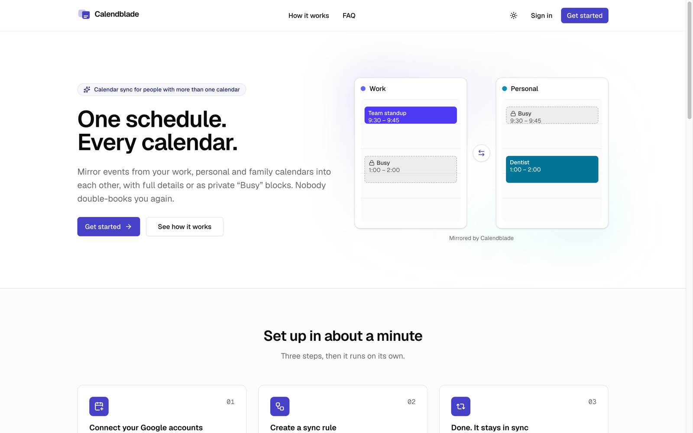
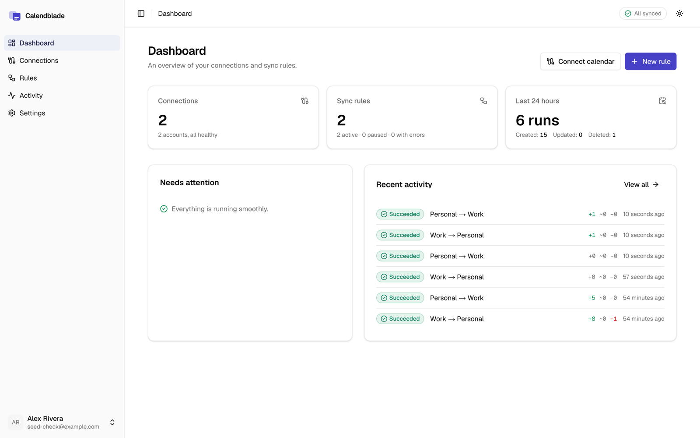
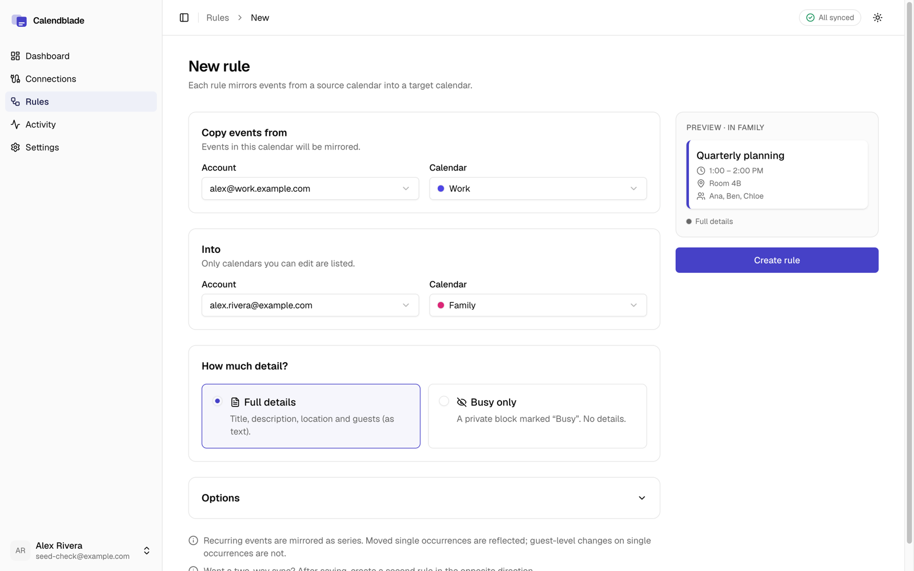

# Calendblade

**Keep every calendar in sync.** Calendblade mirrors events between your Google calendars (work, personal, a shared family calendar) so nobody double-books you again. Each mirror carries either full details or an opaque, private "Busy" block — your choice, per rule.

<p align="center">
  
  
</p>
<p align="center">
  
</p>

## Features

- **Sync rules**: one-way rules from a source calendar to a target calendar.
- **Two modes**: *Full details* (title, description, location, guest list as text) or *Busy only* (private, no details).
- **Two-way sync**: create two rules in opposite directions; a loop guard guarantees mirrors are never mirrored back.
- **Fast and reliable**: Google push notifications trigger syncs within seconds; a 5-minute cron is the safety net.
- **Filters**: include or skip all-day, declined, tentative and private events; per-rule sync window, title prefix, busy title and color.
- **Recurring events**: series are mirrored as series; moved and cancelled occurrences are reflected.
- **Respectful mirrors**: no attendees (no surprise invitations), reminders off, only ids and a fingerprint stored — never event content.
- **Privacy by design**: GDPR/LGPD-ready cookie consent (optional telemetry loads only after opt-in), data export, self-service account deletion, privacy policy, terms and cookie policy.
- **Activity log**, needs-reauth handling, lifecycle emails, light/dark themes, i18n-ready.

## Tech stack

Next.js 16 (App Router, Cache Components, React Compiler) · React 19 · TypeScript · Bun · Tailwind CSS v4 + shadcn/ui · Drizzle ORM + PostgreSQL · Better Auth (Google + magic link, Stripe plugin) · next-intl · Stripe · Resend/SMTP + React Email · Sentry · PostHog · Vitest + Playwright · Biome.

## Quick start (contributors)

```bash
bun install
docker compose up -d          # Postgres (:5433) + Mailpit (:8025)
bun run setup:env             # .env.local from .env.example with generated secrets
bun run db:migrate
bun run db:seed               # optional demo data
bun dev                       # http://localhost:3100
```

With the defaults you can sign in with a magic link (a dev button opens it for you), connect **demo accounts** backed by an in-memory fixture provider, and create rules — no Google, Stripe or email credentials needed. See [CONTRIBUTING.md](./CONTRIBUTING.md).

## Self-hosting

Calendblade runs anywhere Node and Postgres run. Billing and telemetry are optional; you need Postgres, an SMTP server and your own Google OAuth app. See [docs/self-hosting.md](./docs/self-hosting.md).

## Documentation

- [Architecture](./docs/architecture.md)
- [Self-hosting](./docs/self-hosting.md)
- [Environment variables](./.env.example)
- [Contributing](./CONTRIBUTING.md) · [Security](./SECURITY.md) · [Code of Conduct](./CODE_OF_CONDUCT.md)

## Scripts

| Command | Description |
| --- | --- |
| `bun dev` | Development server on port 3100 |
| `bun run build` / `bun run start` | Production build / server |
| `bun run lint` / `bun run format` | Biome |
| `bun run typecheck` | Type check |
| `bun run test` | Unit + integration tests (Vitest) |
| `bun run test:e2e` | End-to-end tests (Playwright) |
| `bun run i18n:check` | Locale completeness check |
| `bun run db:generate` / `db:migrate` / `db:seed` / `db:studio` | Database tooling |

## License

The source code is licensed under the [GNU Affero General Public License v3.0](./LICENSE).

**Trademark notice:** the code is open source; the Calendblade name and logo are not. Forks and hosted copies must use their own name and branding (configurable through the `NEXT_PUBLIC_BRAND_NAME` and related variables).
